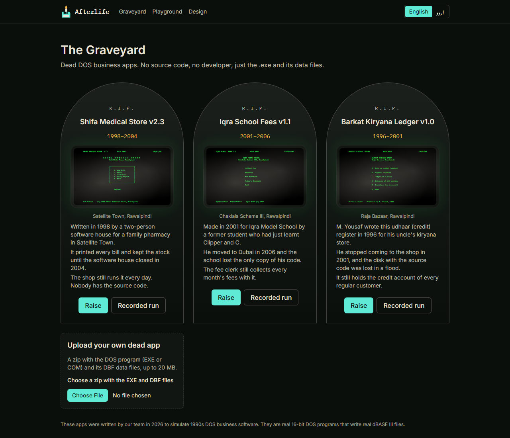
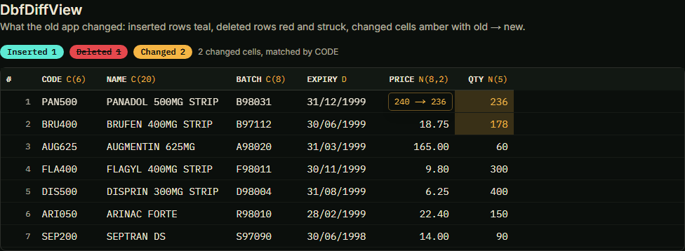
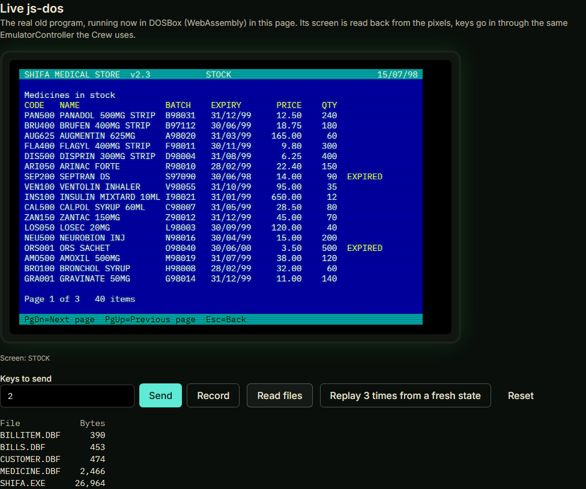
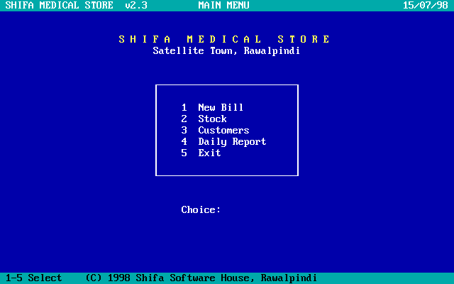

# Afterlife

[](LICENSE)

> Software that outlives its source code.

Afterlife brings dead DOS business software (Clipper/dBase/FoxPro era) back to life without source code. It drives the old app in an emulator, learns its rules from `.DBF` data diffs, writes a typed "Soul" and a Kiro spec, runs it as an offline-first PWA, and proves the new app behaves like the old one with differential property-based tests.

Built for Kiroween 2026 (category: Resurrection) by Matrix AE.

## Layout

- `apps/web`, `apps/api`, `apps/worker`: the Studio, the API and the job worker
- `packages/*`: soul, vessel, dbf, screen, emulator, oracle, crew, certificate, mcp-emulator, ui, db (Drizzle schema and migrations)
- `powers/afterlife`, `samples/graveyard`, `e2e`, `docs`

See [plan.md](plan.md) for the plan and [prompt.md](prompt.md) for the build prompts. Progress is tracked in [docs/progress.md](docs/progress.md). Deployment steps are in [docs/deploy.md](docs/deploy.md).

## Commands

| Command                 | What it does                                                                                   |
| ----------------------- | ---------------------------------------------------------------------------------------------- |
| `pnpm dev`              | Run all apps in dev mode                                                                       |
| `pnpm build`            | Build everything                                                                               |
| `pnpm test`             | Vitest across the workspace                                                                    |
| `pnpm e2e`              | Playwright end-to-end tests                                                                    |
| `pnpm lint`             | ESLint                                                                                         |
| `pnpm typecheck`        | TypeScript strict checks                                                                       |
| `pnpm verify`           | lint, typecheck, test and e2e, all of them                                                     |
| `pnpm ci:local`         | Everything CI did: verify with 2000 property runs, production e2e, Docker builds and smoke     |
| API docs                | `http://localhost:4000/api/docs` (Swagger UI) and `/api/openapi.json` while `pnpm dev` runs    |
| `pnpm pipeline:record`  | Run the real pipeline on each Graveyard app and save it for demo mode (`apps/worker/recorded`) |
| `pnpm db:migrate`       | Apply the database migrations to `DATABASE_URL` (the API also does it when it starts)          |
| `pnpm db:migrate:down`  | Undo the newest migration                                                                      |
| `pnpm db:seed`          | Add the three Graveyard projects (safe to run again)                                           |
| `pnpm db:generate`      | Write the next migration from `packages/db/src/schema.ts` (then write its `.down.sql`)         |
| `pnpm screenshots`      | Retake the UI tour in `docs/screenshots`                                                       |
| `pnpm mcp:gif`          | Record the MCP demo GIF from a real session (`apps/web/public/mcp/afterlife-mcp.gif`)          |
| `pnpm screen:capture`   | Record the VGA fonts and real js-dos frames of the sample apps (screen decoder fixtures)       |
| `pnpm smoke:prod <url>` | The `@smoke` Playwright tests against a deployed site                                          |

## How we test

GitHub Actions is off for this repo, so every check runs locally. The workflow files in `.github/workflows` stay as documentation.

1. **pre-commit** (Husky): ESLint and Prettier on staged files, `pnpm typecheck`, then the whole Vitest suite. The `*.pg.test.ts` tests and the e2e API run on a throwaway Postgres 16 that they start in Docker, so Docker must be running (or set `TEST_DATABASE_URL` and `E2E_DATABASE_URL` to a Postgres you own).
2. **commit-msg**: commitlint, Conventional Commits.
3. **pre-push**: `pnpm verify` (lint, typecheck, unit and property tests, Playwright e2e). A red test means nothing is pushed.
4. **Before merging a PR**: `pnpm ci:local`. It also runs every property test with `FC_NUM_RUNS=2000`, Playwright against the production build, and the API and worker Docker builds with a smoke test.
5. **Nightly**: a Kiro Crew scheduled job runs `pnpm ci:local` on `main` and sends the result.
6. **After a deploy**: `pnpm smoke:prod <url>`.

Current counts: 1052 unit and property tests in 63 files (integration tests included), and 87 Playwright tests (Prompt 30, after the review fixes). The worker integration tests and several e2e tests run the real sample apps in js-dos (headless Chromium), so a test run boots DOS dozens of times.

## Coverage

Package code coverage from `pnpm test:coverage` (HTML report in `coverage/`). This table is refreshed with each README update (every 20 prompts).

| Metric     | %   | Covered   |
| ---------- | --- | --------- |
| Lines      | 87% | 1411/1623 |
| Statements | 87% | 1717/1966 |
| Functions  | 92% | 402/437   |
| Branches   | 88% | 948/1072  |

As of Prompt 30 (it covers ten times more code than at Prompt 20). Property tests run with `FC_NUM_RUNS=100` in the git hooks and 2000 in `pnpm ci:local`.

## Status

Prompts 1 to 30 are merged.

- **1 to 10, foundation:** the monorepo, steering and hooks, the Haunted Ledger design system, the app shell (English and Urdu), the deploy skeleton.
- **11 to 21, the Graveyard and data:** the DOS toolchain, three sample dead apps (Shifa Medical Store, Iqra School Fees, Barkat Kiryana Ledger) with their legacy bugs, the Graveyard page, the `.DBF` reader, writer, snapshot, diff and viewer, and the DBF inspector API behind the upload card.
- **22 to 25, reading the screen:** a text-mode decoder that reads DOS screens back from emulator pixels by VGA glyph matching (no OCR), screen semantics (menus, fields, tables, messages), a layout fingerprint, and the live `CrtScreen` component.
- **26 to 30, driving the old app:** the `EmulatorController` interface and key language, js-dos v8 in the browser and in a headless worker pool, the action recorder that turns a key press into an observation (screens before and after, and the data diff), and repeatable runs from a fresh state.

`/design` boots the real Shifa EXE in js-dos: you can press keys, record what an action changed in the data files, and replay it from a fresh state. Details are in [docs/progress.md](docs/progress.md).

## Screenshots

Taken by `pnpm screenshots` from the real app.

| Graveyard                                       | Graveyard in Urdu                                            | DBF diff                                              |
| ----------------------------------------------- | ------------------------------------------------------------ | ----------------------------------------------------- |
|  |  |  |

| The real Shifa running in js-dos, read back by the decoder | An observation: saving a bill                       |
| ---------------------------------------------------------- | --------------------------------------------------- |
|          |  |

All shots are in [docs/screenshots](docs/screenshots).

## Use Afterlife's emulator from your own Kiro

The `afterlife-emulator` MCP server lets Kiro (or any MCP client) run the sample dead DOS apps and work them like a person: press keys, read the screen, and see what each action changed in the `.DBF` data files. The apps run in js-dos v8 (DOSBox in WebAssembly) in headless Chromium on your machine. The screen is read back from the emulator's pixels by glyph matching, not OCR.



The GIF shows the emulator's real screen after each tool call of a scripted MCP session (`pnpm mcp:gif`): `boot_app shifa`, `send_keys 2` (Stock), `{PgDn}`, `{Esc}`, `snapshot_data`, then a bill for 2 PAN500 and 1 BRU400 saved with `{F2}`, and `diff_data` (2 bill lines inserted).

### Install

1. Clone this repo and run `pnpm install` (Node 22, pnpm 10).
2. Install the browser it runs in: `pnpm --filter @afterlife/e2e exec playwright install chromium`.
3. Add the server to `.kiro/settings/mcp.json` in your workspace (or `~/.kiro/settings/mcp.json` for all workspaces). With a path outside this repo, use the full path to `main.ts`:

   ```json
   {
     "mcpServers": {
       "afterlife-emulator": {
         "command": "node",
         "args": ["--import", "tsx", "packages/mcp-emulator/src/main.ts"],
         "disabled": false,
         "autoApprove": ["list_apps", "read_screen", "read_table", "snapshot_data", "diff_data"]
       }
     }
   }
   ```

   Use `node` directly, not `pnpm`: pnpm prints to stdout, which is the MCP channel. Saving the file reloads Kiro's servers.

4. Ask Kiro: "Boot shifa and show me the stock list."

### Tools

| Tool            | What it does                                                                                                                                                                    |
| --------------- | ------------------------------------------------------------------------------------------------------------------------------------------------------------------------------- |
| `list_apps`     | The apps you can start: `shifa` (pharmacy, 1998), `iqra` (school fees, 2001), `barkat` (kiryana credit ledger, 1996)                                                            |
| `boot_app`      | Starts an app from its original files, with the DOS clock set to its own year. Returns its first screen                                                                         |
| `send_keys`     | Types keys and waits until the screen settles: text as is, `{Enter}`, `{Esc}`, `{F1}`-`{F12}`, `{Up}`, `{PgDn}`, `{Alt+X}`. Returns the new screen and which data files changed |
| `read_screen`   | The 80x25 text and its ScreenModel: title, menu, fields, tables, messages                                                                                                       |
| `snapshot_data` | Remembers the `.DBF` files now, for `diff_data`                                                                                                                                 |
| `diff_data`     | What changed since `snapshot_data`: inserted, deleted and changed records, with exact numeric deltas                                                                            |
| `read_table`    | A `.DBF` table's fields and first records                                                                                                                                       |
| `reset`         | Starts the app again from its original files                                                                                                                                    |

Send one action at a time: a DOS keyboard buffer holds 15 keys. The apps never touch your files; everything runs inside the emulator.

## License

MIT, Matrix AE. The site also serves js-dos (GPL-2.0, used unmodified) and open fonts: see [THIRD_PARTY_NOTICES.md](THIRD_PARTY_NOTICES.md).
