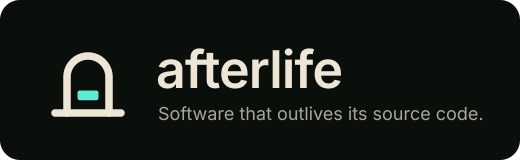
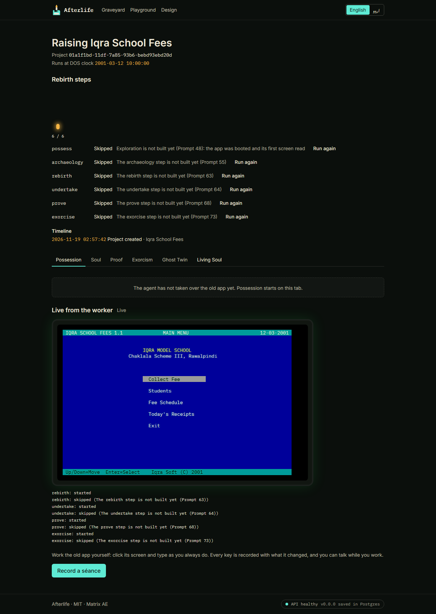
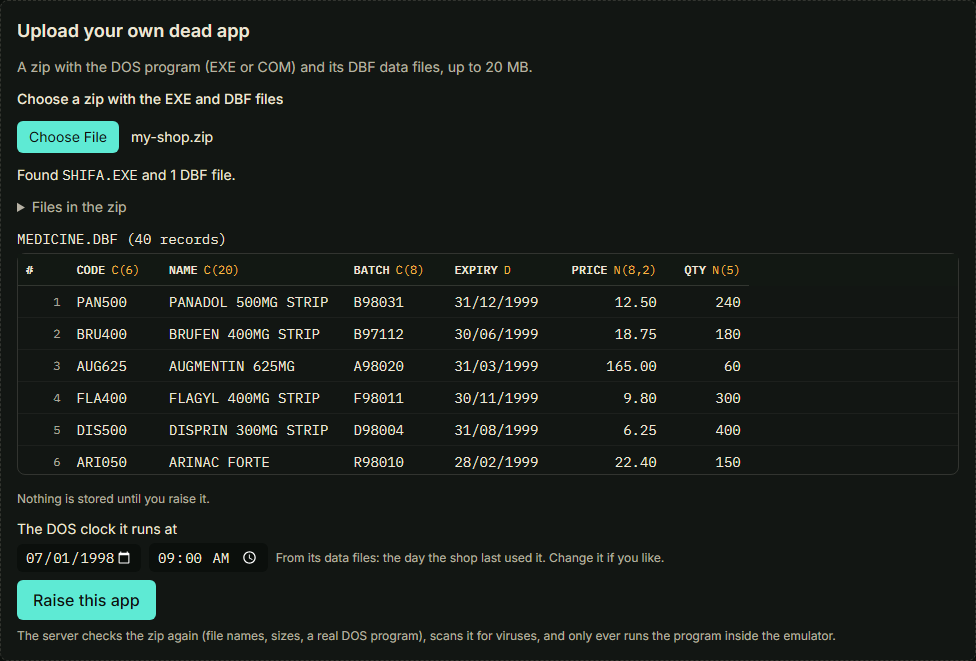
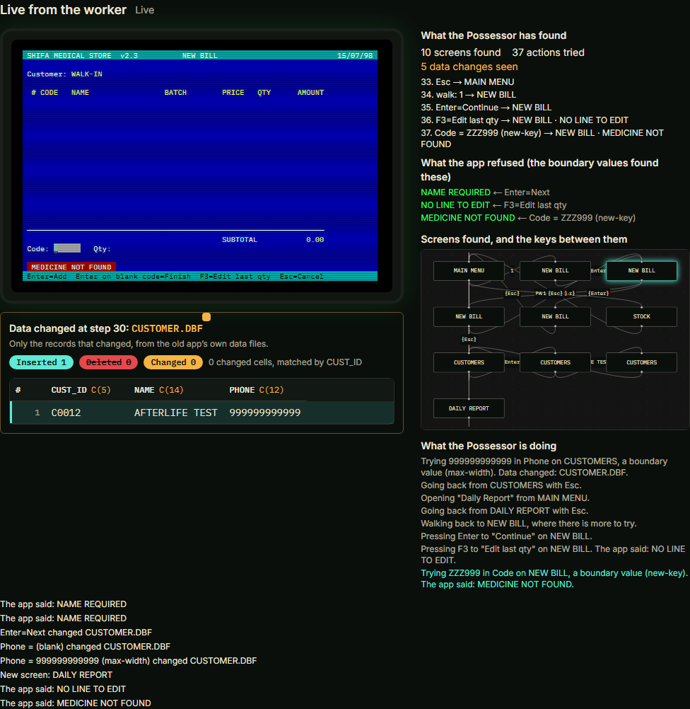
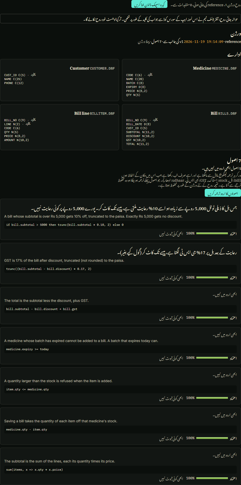

<p align="center">
  
</p>

# Afterlife

[](LICENSE)

> Software that outlives its source code.

Afterlife brings dead DOS business software (Clipper/dBase/FoxPro era) back to life without source code. It drives the old app in an emulator, learns its rules from `.DBF` data diffs, writes a typed "Soul" and a Kiro spec, runs it as an offline-first PWA, and proves the new app behaves like the old one with differential property-based tests.

Built for Kiroween 2026 (category: Resurrection) by Matrix AE.

## Layout

- `apps/web`, `apps/api`, `apps/worker`: the Studio, the API and the job worker
- `packages/*`: soul, vessel, dbf, screen, emulator, oracle, crew, certificate, mcp-emulator, ui, db (Drizzle schema and migrations)
- `powers/afterlife`, `samples/graveyard`, `e2e`, `docs`
- `docs/brand`: the logo (a tombstone with a DOS cursor inside it: the dead app, running again), as a mark, an app icon and this banner. All three are made from `packages/ui/src/brand.ts` and the design tokens, and a test keeps them current.

See [plan.md](plan.md) for the plan and [prompt.md](prompt.md) for the build prompts. Progress is tracked in [docs/progress.md](docs/progress.md). Deployment steps are in [docs/deploy.md](docs/deploy.md).

## Commands

| Command                  | What it does                                                                                   |
| ------------------------ | ---------------------------------------------------------------------------------------------- |
| `pnpm dev`               | Run all apps in dev mode                                                                       |
| `pnpm build`             | Build everything                                                                               |
| `pnpm test`              | Vitest across the workspace                                                                    |
| `pnpm e2e`               | Playwright end-to-end tests                                                                    |
| `pnpm lint`              | ESLint                                                                                         |
| `pnpm typecheck`         | TypeScript strict checks                                                                       |
| `pnpm verify`            | lint, typecheck, test and e2e, all of them                                                     |
| `pnpm ci:local`          | Everything CI did: verify with 2000 property runs, production e2e, Docker builds and smoke     |
| API docs                 | `http://localhost:4000/api/docs` (Swagger UI) and `/api/openapi.json` while `pnpm dev` runs    |
| `pnpm pipeline:record`   | Run the real pipeline on each Graveyard app and save it for demo mode (`apps/worker/recorded`) |
| `pnpm db:migrate`        | Apply the database migrations to `DATABASE_URL` (the API also does it when it starts)          |
| `pnpm db:migrate:down`   | Undo the newest migration                                                                      |
| `pnpm db:seed`           | Add the three Graveyard projects (safe to run again)                                           |
| `pnpm db:generate`       | Write the next migration from `packages/db/src/schema.ts` (then write its `.down.sql`)         |
| `pnpm screenshots`       | Retake the UI tour in `docs/screenshots`                                                       |
| `pnpm mcp:gif`           | Record the MCP demo GIF from a real session (`apps/web/public/mcp/afterlife-mcp.gif`)          |
| `pnpm screen:capture`    | Record the VGA fonts and real js-dos frames of the sample apps (screen decoder fixtures)       |
| `pnpm smoke:prod <url>`  | The `@smoke` Playwright tests against a deployed site                                          |
| `pnpm test:coverage`     | Vitest with coverage (the table below; HTML report in `coverage/`)                             |
| `pnpm soul:spec`         | Write the Kiro spec of a Soul: `pnpm soul:spec <soul.json \| --example> <dir>`                 |
| `pnpm score:archaeology` | Score the Archaeologist against each sample's hidden rules (`--write` updates the score below) |

## How we test

GitHub Actions is off for this repo, so every check runs locally. The workflow files in `.github/workflows` stay as documentation.

1. **pre-commit** (Husky): ESLint and Prettier on staged files, `pnpm typecheck`, then the whole Vitest suite. The `*.pg.test.ts` tests and the e2e API run on a throwaway Postgres 16 that they start in Docker, so Docker must be running (or set `TEST_DATABASE_URL` and `E2E_DATABASE_URL` to a Postgres you own).
2. **commit-msg**: commitlint, Conventional Commits.
3. **pre-push**: `pnpm verify` (lint, typecheck, unit and property tests, Playwright e2e). A red test means nothing is pushed.
4. **Before merging a PR**: `pnpm ci:local`. It also runs every property test with `FC_NUM_RUNS=2000`, Playwright against the production build, and the API and worker Docker builds with a smoke test.
5. **Nightly** (planned, not set up yet): a Kiro Crew scheduled job will run `pnpm ci:local` on its own clone of `main` and send the result.
6. **After a deploy**: `pnpm smoke:prod <url>`.

Current counts: 1775 unit and property tests in 177 files (integration and Postgres tests included), and 140 Playwright tests (after the review of 51 to 60). The worker integration tests and several e2e tests run the real sample apps in js-dos (headless Chromium), so a test run boots DOS dozens of times.

## Coverage

Package code coverage from `pnpm test:coverage` (HTML report in `coverage/`). This table is refreshed with each README update (every 20 prompts).

| Metric     | %   | Covered   |
| ---------- | --- | --------- |
| Lines      | 91% | 5452/5977 |
| Statements | 90% | 6452/7161 |
| Functions  | 93% | 1638/1762 |
| Branches   | 85% | 3722/4380 |

As of Prompt 60. The code covered grew by a third since Prompt 50 (the Archaeologist, the Vessel runtime, its stores and its sync), and line coverage rose from 90% to 91%. Property tests run with `FC_NUM_RUNS=100` in the git hooks and 2000 in `pnpm ci:local`.

## Status

Prompts 1 to 60 are merged, with a review round after every ten. The review of 51 to 60 fixed three bugs in the reborn app's sync and stock checks (two syncs at once could lose a sale; a phone could send its outbox twice at once; two lines of one medicine could sell more than the stock), and its findings for Kiro are done: the Archaeologist infers the actions, finds rules without a model and types its probe bills into the old app; the model table is by family; the screen graph groups states under their screen; and small fixes in the reborn app and the Soul tab. For Prompt 33, Kiro drove Shifa through MCP in a real chat; the transcript is in `docs/kiro-usage.md`.

- **1 to 10, foundation:** the monorepo, steering and hooks, the Haunted Ledger design system, the app shell (English and Urdu), the deploy skeleton.
- **11 to 21, the Graveyard and data:** the DOS toolchain, three sample dead apps (Shifa Medical Store, Iqra School Fees, Barkat Kiryana Ledger) with their legacy bugs, the Graveyard page, the `.DBF` reader, writer, snapshot, diff and viewer, and the DBF inspector API behind the upload card.
- **22 to 25, reading the screen:** a text-mode decoder that reads DOS screens back from emulator pixels by VGA glyph matching (no OCR), screen semantics (menus, fields, tables, messages), a layout fingerprint, and the live `CrtScreen` component.
- **26 to 30, driving the old app:** the `EmulatorController` interface and key language, js-dos v8 in the browser and in a headless worker pool, the action recorder that turns a key press into an observation (screens before and after, and the data diff), and repeatable runs from a fresh state.

- **31 to 34, the séance and MCP:** the owner records a séance on the live old app (keys, screens, data changes, an optional voice note); an MCP server that lets Kiro boot and drive the sample apps, with its guide at `/docs/mcp`.
- **35 to 40, API, worker and data:** Postgres with Drizzle (migrations up and down), the projects API with OpenAPI docs and per-visitor rate limits, a pg-boss job loop in the worker, live progress over WebSocket (Postgres `LISTEN/NOTIFY`), the pipeline that runs the six Crew steps in order with resume and "Run again", a labelled "Recorded run" demo mode, and uploading your own dead app (zip checks, a ClamAV virus scan, a server-built js-dos bundle, its own DOS clock).

- **41 to 46, the Soul:** the Soul IR in zod with a reference Soul of Shifa written by our team as the answer key, a rule expression language (our own parser and decimal evaluator, no `eval`) with a "Try a rule" playground, a Kiro spec writer (requirements in EARS, design, tasks and a steering file, checked by Kiro's own spec checker), the Soul tab with evidence and a spec download, immutable Soul versions with a diff view, and rules in Urdu (a shop-word glossary, cached per rule).
- **47 to 50, the Possessor:** an LLM runtime behind `LlmClient` (Amazon Bedrock Converse and a fake for tests, retries, a token budget per project, zod-checked answers, every call on the "Show your work" panel); the Possessor, which explores the old app by itself (a screen graph, the LLM only for field values, Esc to go back, never a key that quits); an input strategy that types boundary values and records what the app refuses; and guided possession, which walks the owner's séance first and attaches their voice notes as hints.
- **51 to 52, watching it work:** the Possession Theater (the screen graph growing live in React Flow, each data change as a card) and a stored screen graph with `replayPath`, the shortest key path to any screen.
- **53 to 57, the Archaeologist:** entities, keys, foreign keys and counters from the data files; the model proposes 3 to 5 candidate rules per value written; every candidate is checked against every observation and only the simplest that explains all of them is kept, with probes when a threshold was never tried ("Try a bill subtotal of exactly 5000 and of 5001."); a score against each sample's hidden rules; and rules that light a candle and write themselves in on the Soul tab.
- **58 to 60, the Vessel:** the runtime that runs a Soul (fields from rules, counters, parent keys and line positions; effects as DBF diffs; Shifa's scripted bills give exactly the real app's diffs), stores in memory, IndexedDB and Postgres; the reborn app at `/vessel/<id>` (the old menu as a bottom bar or a sidebar, a search-as-you-type picker, a running total, Urdu labels); and offline-first: bills saved on the phone with no network, synced when it is back, stock conflicts listed for the owner.

### What works today, and what does not yet

- **Works:** possession explores for real (on Shifa, 47 actions find 5 screens in 11 states, 6 data changes and 4 of the app's refusals). With no language model, the Archaeologist infers the actions (save a bill, add a customer) and finds the rules: on real Shifa it typed 7 probe bills into the old app (12.50 to 10,001) and found all 8 of the reference Soul's computed rules, the 10% discount over Rs 5,000 and the GST after it included. A recorded run of Shifa opens that Soul in the reborn app, which makes the bill with the old app's numbers. The Possession Theater, the rule check, the live rule animation, and the reborn app all work in the browser. The reborn app matches the 1998 app to the paisa (8 insulin: 5,200.00, 520.00 off, GST 795.60, total 5,475.60), in English and Urdu, and offline.
- **Not yet:** without a model, the rules that refuse something (an expired batch, more than the stock) are not found, nor Iqra's fees by class and Barkat's credit limit (scores below). Most of the e2e tests of the reborn app still run the reference Soul our team wrote from the C source, so their numbers are checked against a known answer. The rebirth, undertake, prove and exorcise steps still say "not built yet (Prompt N)" and are marked skipped, never done.
- **Next:** Prompts 61 to 80, each from a Kiro spec in `.kiro/specs/`: receipts, export, the Surgeon, the Undertaker, the Oracle and the certificate, the Exorcist, and Ghost Twin.

`/design` boots the real Shifa EXE in js-dos: you can press keys, record what an action changed in the data files, and replay it from a fresh state. Details are in [docs/progress.md](docs/progress.md).

## Archaeology score

Each sample app hides its business rules in its manifest (`knownRules`, with the truth our team wrote from the C source). `pnpm score:archaeology` runs the Archaeologist on the app's data files and its recorded possession and scores the Soul it finds: a hidden rule is recovered when the Soul has the same counter, or a rule for the same value that is the same expression (exact) or gives the same value on every scripted scenario run that shows the rule (equivalent). `tests/archaeology-score.test.ts` fails if the score drops, so the nightly `pnpm ci:local` checks it.

<!-- archaeology-score:start -->

**Without a language model** (keys and counters from the data, and rules found by listing short expressions over the recorded observations, probes included, and keeping those that explain every one):

- Afterlife recovered 5 of 7 hidden rules in Shifa Medical Store (4 exact). Precision 100%, recall 71%.
- Afterlife recovered 1 of 6 hidden rules in Iqra School Fees (1 exact). Precision 100%, recall 17%.
- Afterlife recovered 2 of 5 hidden rules in Barkat Kiryana Ledger (1 exact). Precision 100%, recall 40%.

<!-- archaeology-score:end -->

## Screenshots

Taken by `pnpm screenshots` from the real app.

| Graveyard                                       | Graveyard in Urdu                                            | DBF diff                                              |
| ----------------------------------------------- | ------------------------------------------------------------ | ----------------------------------------------------- |
|  |  |  |

| The real Shifa running in js-dos, read back by the decoder | An observation: saving a bill                       |
| ---------------------------------------------------------- | --------------------------------------------------- |
|          |  |

| A raised project: the worker's live screen and the six steps | Upload your own dead app                                   |
| ------------------------------------------------------------ | ---------------------------------------------------------- |
|     |  |

| Possession: what the Possessor found, and what the old app refused | The Soul tab in Urdu: each rule in Urdu, English and the DSL |
| ------------------------------------------------------------------ | ------------------------------------------------------------ |
|                   |    |

All shots are in [docs/screenshots](docs/screenshots).

## Use Afterlife's emulator from your own Kiro

The `afterlife-emulator` MCP server lets Kiro (or any MCP client) run the sample dead DOS apps and work them like a person: press keys, read the screen, and see what each action changed in the `.DBF` data files. The apps run in js-dos v8 (DOSBox in WebAssembly) in headless Chromium on your machine. The screen is read back from the emulator's pixels by glyph matching, not OCR.


The GIF shows the emulator's real screen after each tool call of a scripted MCP session (`pnpm mcp:gif`): `boot_app shifa`, `send_keys 2` (Stock), `{PgDn}`, `{Esc}`, `snapshot_data`, then a bill for 2 PAN500 and 1 BRU400 saved with `{F2}`, and `diff_data` (2 bill lines inserted).

### Install

1. Clone this repo and run `pnpm install` (Node 22, pnpm 10).
2. Install the browser it runs in: `pnpm --filter @afterlife/e2e exec playwright install chromium`.
3. Add the server to `.kiro/settings/mcp.json` in your workspace (or `~/.kiro/settings/mcp.json` for all workspaces). With a path outside this repo, use the full path to `main.ts`:

   ```json
   {
     "mcpServers": {
       "afterlife-emulator": {
         "command": "node",
         "args": ["--import", "tsx", "packages/mcp-emulator/src/main.ts"],
         "disabled": false,
         "autoApprove": ["list_apps", "read_screen", "read_table", "snapshot_data", "diff_data"]
       }
     }
   }
   ```

   Use `node` directly, not `pnpm`: pnpm prints to stdout, which is the MCP channel. Saving the file reloads Kiro's servers.

4. Ask Kiro: "Boot shifa and show me the stock list."

### Tools

| Tool            | What it does                                                                                                                                                                    |
| --------------- | ------------------------------------------------------------------------------------------------------------------------------------------------------------------------------- |
| `list_apps`     | The apps you can start: `shifa` (pharmacy, 1998), `iqra` (school fees, 2001), `barkat` (kiryana credit ledger, 1996)                                                            |
| `boot_app`      | Starts an app from its original files, with the DOS clock set to its own year. Returns its first screen                                                                         |
| `send_keys`     | Types keys and waits until the screen settles: text as is, `{Enter}`, `{Esc}`, `{F1}`-`{F12}`, `{Up}`, `{PgDn}`, `{Alt+X}`. Returns the new screen and which data files changed |
| `read_screen`   | The 80x25 text and its ScreenModel: title, menu, fields, tables, messages                                                                                                       |
| `snapshot_data` | Remembers the `.DBF` files now, for `diff_data`                                                                                                                                 |
| `diff_data`     | What changed since `snapshot_data`: inserted, deleted and changed records, with exact numeric deltas                                                                            |
| `read_table`    | A `.DBF` table's fields and first records                                                                                                                                       |
| `reset`         | Starts the app again from its original files                                                                                                                                    |

Send one action at a time: a DOS keyboard buffer holds 15 keys. The apps never touch your files; everything runs inside the emulator.

## License

MIT, Matrix AE. The site also serves js-dos (GPL-2.0, used unmodified) and open fonts: see [THIRD_PARTY_NOTICES.md](THIRD_PARTY_NOTICES.md).
