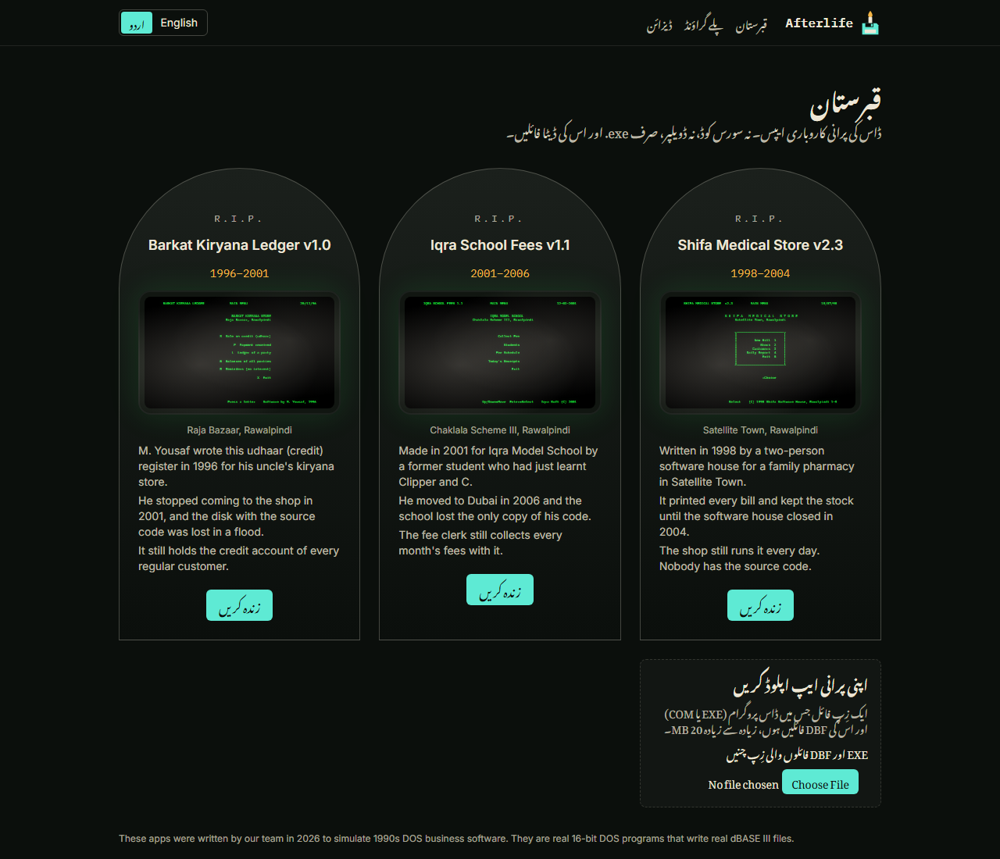

<p align="center">
  
</p>

# Afterlife

[](LICENSE)

> Software that outlives its source code.

Afterlife brings dead DOS business software (Clipper/dBase/FoxPro era) back to life without source code. It drives the old app in an emulator, learns its rules from `.DBF` data diffs, writes a typed "Soul" and a Kiro spec, runs it as an offline-first PWA, and proves the new app behaves like the old one with differential property-based tests.

Built for Kiroween 2026 (category: Resurrection) by Matrix AE.

## Layout

- `apps/web`, `apps/api`, `apps/worker`: the Studio, the API and the job worker
- `packages/*`: soul, vessel, dbf, screen, emulator, oracle, crew, certificate, twin, mcp-emulator, ui, db (Drizzle schema and migrations)
- `powers/afterlife`, `samples/graveyard`, `e2e`, `docs`
- `docs/brand`: the logo (a tombstone with a DOS cursor inside it: the dead app, running again), as a mark, an app icon and this banner. All three are made from `packages/ui/src/brand.ts` and the design tokens, and a test keeps them current.

See [plan.md](plan.md) for the plan and [prompt.md](prompt.md) for the build prompts. Progress is tracked in [docs/progress.md](docs/progress.md). Deployment steps are in [docs/deploy.md](docs/deploy.md).

## Commands

| Command                  | What it does                                                                                   |
| ------------------------ | ---------------------------------------------------------------------------------------------- |
| `pnpm dev`               | Run all apps in dev mode                                                                       |
| `pnpm build`             | Build everything                                                                               |
| `pnpm test`              | Vitest across the workspace                                                                    |
| `pnpm e2e`               | Playwright end-to-end tests                                                                    |
| `pnpm lint`              | ESLint                                                                                         |
| `pnpm typecheck`         | TypeScript strict checks                                                                       |
| `pnpm verify`            | lint, typecheck, test and e2e, all of them                                                     |
| `pnpm ci:local`          | Everything CI did: verify with 2000 property runs, production e2e, Docker builds and smoke     |
| API docs                 | `http://localhost:4000/api/docs` (Swagger UI) and `/api/openapi.json` while `pnpm dev` runs    |
| `pnpm pipeline:record`   | Run the real pipeline on each Graveyard app and save it for demo mode (`apps/worker/recorded`) |
| `pnpm db:migrate`        | Apply the database migrations to `DATABASE_URL` (the API also does it when it starts)          |
| `pnpm db:migrate:down`   | Undo the newest migration                                                                      |
| `pnpm db:seed`           | Add the three Graveyard projects (safe to run again)                                           |
| `pnpm db:generate`       | Write the next migration from `packages/db/src/schema.ts` (then write its `.down.sql`)         |
| `pnpm screenshots`       | Retake the UI tour in `docs/screenshots`                                                       |
| `pnpm mcp:gif`           | Record the MCP demo GIF from a real session (`apps/web/public/mcp/afterlife-mcp.gif`)          |
| `pnpm screen:capture`    | Record the VGA fonts and real js-dos frames of the sample apps (screen decoder fixtures)       |
| `pnpm smoke:prod <url>`  | The `@smoke` Playwright tests against a deployed site                                          |
| `pnpm test:coverage`     | Vitest with coverage (the table below; HTML report in `coverage/`)                             |
| `pnpm soul:spec`         | Write the Kiro spec of a Soul: `pnpm soul:spec <soul.json \| --example> <dir>`                 |
| `pnpm score:archaeology` | Score the Archaeologist against each sample's hidden rules (`--write` updates the score below) |
| `pnpm proof:shifa`       | The differential proof of the real 1998 Shifa against its Soul, strict and Y2K, on 4 emulators |
| `pnpm cert:key`          | Make an Ed25519 key pair for Rebirth Certificates (`CERT_SIGNING_KEY`, `CERT_PUBLIC_KEY`)      |
| `pnpm twin`              | `afterlife-twin`, the Ghost Twin capture tool for a shop PC (see `docs/twin.md`)               |
| `pnpm twin:record`       | Record a shop week in the real Shifa app for "Simulate a day in the shop"                      |

## How we test

GitHub Actions is off for this repo, so every check runs locally. The workflow files in `.github/workflows` stay as documentation.

1. **pre-commit** (Husky): ESLint and Prettier on staged files, `pnpm typecheck`, then the whole Vitest suite. The `*.pg.test.ts` tests and the e2e API run on a throwaway Postgres 16 that they start in Docker, so Docker must be running (or set `TEST_DATABASE_URL` and `E2E_DATABASE_URL` to a Postgres you own).
2. **commit-msg**: commitlint, Conventional Commits.
3. **pre-push**: `pnpm verify` (lint, typecheck, unit and property tests, Playwright e2e). A red test means nothing is pushed.
4. **Before merging a PR**: `pnpm ci:local`. It also runs every property test with `FC_NUM_RUNS=2000`, Playwright against the production build, and the API and worker Docker builds with a smoke test.
5. **Nightly** (planned, not set up yet): a Kiro Crew scheduled job will run `pnpm ci:local` on its own clone of `main` and send the result.
6. **After a deploy**: `pnpm smoke:prod <url>`.

Current counts: 2119 unit and property tests in 238 files (integration and Postgres tests included), and 154 Playwright tests (as of Prompt 80). The worker integration tests and several e2e tests run the real sample apps in js-dos (headless Chromium), so a test run boots DOS dozens of times.

## Coverage

Package code coverage from `pnpm test:coverage` (HTML report in `coverage/`). This table is refreshed with each README update (every 20 prompts).

| Metric     | %   | Covered     |
| ---------- | --- | ----------- |
| Lines      | 93% | 8590/9226   |
| Statements | 92% | 10262/11165 |
| Functions  | 94% | 2638/2793   |
| Branches   | 85% | 6089/7149   |

As of Prompt 80. The code covered grew by half since Prompt 60 (receipts and export, the Surgeon, the Undertaker, the Oracle, the certificate, the Exorcist, Ghost Twin and the speech client), and line coverage rose from 91% to 93%. On a busy machine, run it with fewer workers (`pnpm exec vitest run --coverage --maxWorkers 3`): with every file at once under coverage, the Postgres and emulator tests time out. Property tests run with `FC_NUM_RUNS=100` in the git hooks and 2000 in `pnpm ci:local`.

## Status

Prompts 1 to 80 are merged. Review rounds ran after every ten prompts up to 60, then one for 61 to 80. Its 11 fixes are merged: the switch-over after a bill made on a phone, `afterlife-twin` after a restart or a switch-over, the twin feed past 500 changes, no certificate when most proof cases were skipped, why a case failed on the Proof tab, the certificate on phones, Roman Urdu number words, the certificate keys on Render, menus written "1. Item", and two Possessor fixes from a blind test. For Prompt 33, Kiro drove Shifa through MCP in a real chat; the transcript is in `docs/kiro-usage.md`.

- **1 to 10, foundation:** the monorepo, steering and hooks, the Haunted Ledger design system, the app shell (English and Urdu), the deploy skeleton.
- **11 to 21, the Graveyard and data:** the DOS toolchain, three sample dead apps (Shifa Medical Store, Iqra School Fees, Barkat Kiryana Ledger) with their legacy bugs, the Graveyard page, the `.DBF` reader, writer, snapshot, diff and viewer, and the DBF inspector API behind the upload card.
- **22 to 25, reading the screen:** a text-mode decoder that reads DOS screens back from emulator pixels by VGA glyph matching (no OCR), screen semantics (menus, fields, tables, messages), a layout fingerprint, and the live `CrtScreen` component.
- **26 to 30, driving the old app:** the `EmulatorController` interface and key language, js-dos v8 in the browser and in a headless worker pool, the action recorder that turns a key press into an observation (screens before and after, and the data diff), and repeatable runs from a fresh state.
- **31 to 34, the séance and MCP:** the owner records a séance on the live old app (keys, screens, data changes, an optional voice note); an MCP server that lets Kiro boot and drive the sample apps, with its guide at `/docs/mcp`.
- **35 to 40, API, worker and data:** Postgres with Drizzle (migrations up and down), the projects API with OpenAPI docs and per-visitor rate limits, a pg-boss job loop in the worker, live progress over WebSocket (Postgres `LISTEN/NOTIFY`), the pipeline that runs the six Crew steps in order with resume and "Run again", a labelled "Recorded run" demo mode, and uploading your own dead app (zip checks, a ClamAV virus scan, a server-built js-dos bundle, its own DOS clock).
- **41 to 46, the Soul:** the Soul IR in zod with a reference Soul of Shifa written by our team as the answer key, a rule expression language (our own parser and decimal evaluator, no `eval`) with a "Try a rule" playground, a Kiro spec writer (requirements in EARS, design, tasks and a steering file, checked by Kiro's own spec checker), the Soul tab with evidence and a spec download, immutable Soul versions with a diff view, and rules in Urdu (a shop-word glossary, cached per rule).
- **47 to 50, the Possessor:** an LLM runtime behind `LlmClient` (Amazon Bedrock Converse and a fake for tests, retries, a token budget per project, zod-checked answers, every call on the "Show your work" panel); the Possessor, which explores the old app by itself; an input strategy that types boundary values and records what the app refuses; and guided possession, which walks the owner's séance first.
- **51 to 57, watching it work, and the Archaeologist:** the Possession Theater (the screen graph growing live in React Flow) and `replayPath`; entities, keys and counters from the data files; candidate rules checked against every observation, the simplest that explains all of them kept, with probes typed into the old app when a threshold was never tried; a score against each sample's hidden rules.
- **58 to 60, the Vessel:** the runtime that runs a Soul, its stores (memory, IndexedDB, Postgres), the reborn app at `/vessel/<id>` in English and Urdu, and offline-first sync with stock conflicts listed for the owner.
- **61 to 62, receipts and export:** the old app's bill screen as an 80 mm receipt, WhatsApp text and a PDF; "Export the reborn app" downloads a standalone Next.js app running the Soul, with its Kiro spec and tests.
- **63 to 66, the Surgeon and the Undertaker:** the rebirth step compiles and smoke-tests every action and publishes the reborn app; the undertake step migrates the old records field by field, rejects what cannot be converted with a reason, and reconciles counts, sums, stock value and balances to the paisa, shown as the "Data crossing" panel.
- **67 to 70, the Oracle:** cases made up from the Soul with fast-check and aimed at the rules' thresholds; the differential runner drives the real old app in headless js-dos and the Vessel in lockstep on parallel lanes; the first difference is shrunk to a minimal case and explained in one sentence; the Proof tab shows it live. On Shifa it found the app's Y2K expiry bug by itself.
- **71 to 72, the Rebirth Certificate:** RFC 8785 canonical JSON signed with Ed25519, issued only for 0 failed cases and reconciled data; `/verify/<id>` checks the signature in the browser, with a QR code and a PDF, and shows a tampered file as invalid.
- **73 to 75, the Exorcist:** deterministic detectors for two-digit years, overflow, negative stock, date arithmetic and more, with evidence from the old app's own screens; Keep or Fix for each; a fix becomes a new Soul version, proved again, with the fix listed on the certificate as an accepted divergence. The Exorcism tab shows each bug as a ghost card.
- **76 to 79, Ghost Twin:** `afterlife-twin` watches a real shop's data folder and sends each change; the worker replays it in the reborn app and compares; readiness (7 days, 200 matched, 0 open mismatches, configurable); switch-over migrates one last time and freezes the old data. The Ghost Twin tab has a candle per shop day, the twin pairs, the readiness meter and "Simulate a day in the shop", from a week recorded in the real 1998 app (216 transactions).
- **80, the speech client:** Amazon Transcribe behind `SpeechClient` with a fallback provider, and a normaliser that reads numbers as they are said ("paanch feesad" is 5%, in Roman Urdu, Urdu script, English and Devanagari). The Living Soul tab records with MediaRecorder or takes typed text.

### What works today, and what does not yet

- **Works:** the whole flow on Shifa, from the Graveyard to a signed certificate. Possession explores the real app; with no language model the Archaeologist finds all 8 computed rules of the reference Soul (it types 7 probe bills into the old app); the reborn app matches the 1998 app to the paisa, in English and Urdu, and offline; the Undertaker migrates and reconciles; the Oracle's strict proof of Shifa as it really runs gives 188 cases the same and 0 different on 4 emulators; the Exorcist finds the Y2K expiry bug and the negative stock; Fix proves the fixed Soul and issues a certificate listing the divergence; the Ghost Twin week matches every transaction and the shop can switch over.
- **Not yet:** the certificate above comes from the reference Soul our team wrote as the answer key. Without a model, no sample app reaches a certificate from the Soul the pipeline learns itself: the rules that refuse something (an expired batch, more than the stock) are not found, nor Iqra's fees by class and Barkat's credit limit (scores below). On an app we never tuned for (a 1999 weighbridge), possession stopped at the main menu; two fixes came from it, and the rest is Prompt 82. The Exorcist finds 2 of Shifa's 3 hidden bugs: its discount overflow never shows in anything recorded. Amazon Transcribe has no Urdu, so spoken Urdu goes as Hindi and comes back in Devanagari; the Living Soul tab shows the transcript and its numbers, but turning a request into a rule change is Prompts 89 and 90. `afterlife-twin` is tested on temp folders and the recorded week, not yet on a real shop PC.
- **Next:** the prompts below, from 80a to 104.

### What is left: Prompts 80a to 104

Revised after the review of 61 to 80 and our market research ([docs/who-it-is-for.md](docs/who-it-is-for.md)): the people who need Afterlife are registered Pakistani businesses whose old billing program has lost its maker, and FBR's digital invoicing makes them change now. The full prompts are in [prompt.md](prompt.md), each with its "Done when".

- **80a, settings and the Claude API:** the worker and the API read their `.env` files, and the model can come from the Claude API as well as Amazon Bedrock.
- **81 to 84, true for every app:** certificates from the Soul the pipeline learns; what the blind test found; certificate honesty, uploads and twin restarts; deploy for the judges.
- **85 to 88, the apps people really run, and FBR's why-now:** every DBF dialect (FoxPro, Visual FoxPro, dBASE); the FBR digital invoice, then the reborn app in a daylight theme with the old keys and an FBR-ready receipt; raising an app from its data alone.
- **89 and 90, the Living Soul:** a spoken or typed request becomes a verified rule change, and its tab.
- **91 to 93, the Studio:** the landing page with the real pitch; the judge playground; the raise page as one story, with motion and sound.
- **94, Kiro breadth:** the Afterlife power, custom agents and the evidence.
- **95 to 97, hardening:** the golden e2e and the demo cache; security and observability; accessibility, Urdu right to left and phones.
- **98 to 100, submission:** the Kiro write-up and this README; the demo video; the final checklist, with this README refreshed as of Prompt 100 and the submitted commit tagged.
- **101 to 104, after judging ends on 29 January 2027:** owner accounts; FBR live through a licensed integrator; Visual Basic 6, Access and SQL Server apps; ready for a pilot in a real shop.

`/design` boots the real Shifa EXE in js-dos: you can press keys, record what an action changed in the data files, and replay it from a fresh state. Details are in [docs/progress.md](docs/progress.md).

## Archaeology score

Each sample app hides its business rules in its manifest (`knownRules`, with the truth our team wrote from the C source). `pnpm score:archaeology` runs the Archaeologist on the app's data files and its recorded possession and scores the Soul it finds: a hidden rule is recovered when the Soul has the same counter, or a rule for the same value that is the same expression (exact) or gives the same value on every scripted scenario run that shows the rule (equivalent). `tests/archaeology-score.test.ts` fails if the score drops, so the nightly `pnpm ci:local` checks it.

<!-- archaeology-score:start -->

**Without a language model** (keys and counters from the data, and rules found by listing short expressions over the recorded observations, probes included, and keeping those that explain every one):

- Afterlife recovered 5 of 7 hidden rules in Shifa Medical Store (4 exact). Precision 100%, recall 71%.
- Afterlife recovered 1 of 6 hidden rules in Iqra School Fees (1 exact). Precision 100%, recall 17%.
- Afterlife recovered 2 of 5 hidden rules in Barkat Kiryana Ledger (1 exact). Precision 100%, recall 40%.

<!-- archaeology-score:end -->

## Screenshots

Taken by `pnpm screenshots` from the real app.

| Graveyard                                       | Graveyard in Urdu                                            | DBF diff                                              |
| ----------------------------------------------- | ------------------------------------------------------------ | ----------------------------------------------------- |
|  |  |  |

| The real Shifa running in js-dos, read back by the decoder | An observation: saving a bill                       |
| ---------------------------------------------------------- | --------------------------------------------------- |
|          |  |

| A raised project: the worker's live screen and the six steps | Upload your own dead app                                   |
| ------------------------------------------------------------ | ---------------------------------------------------------- |
|     |  |

| Possession: what the Possessor found, and what the old app refused | The Soul tab in Urdu: each rule in Urdu, English and the DSL |
| ------------------------------------------------------------------ | ------------------------------------------------------------ |
|                   |    |

All shots are in [docs/screenshots](docs/screenshots).

## Use Afterlife's emulator from your own Kiro

The `afterlife-emulator` MCP server lets Kiro (or any MCP client) run the sample dead DOS apps and work them like a person: press keys, read the screen, and see what each action changed in the `.DBF` data files. The apps run in js-dos v8 (DOSBox in WebAssembly) in headless Chromium on your machine. The screen is read back from the emulator's pixels by glyph matching, not OCR.


The GIF shows the emulator's real screen after each tool call of a scripted MCP session (`pnpm mcp:gif`): `boot_app shifa`, `send_keys 2` (Stock), `{PgDn}`, `{Esc}`, `snapshot_data`, then a bill for 2 PAN500 and 1 BRU400 saved with `{F2}`, and `diff_data` (2 bill lines inserted).

### Install

1. Clone this repo and run `pnpm install` (Node 22, pnpm 10).
2. Install the browser it runs in: `pnpm --filter @afterlife/e2e exec playwright install chromium`.
3. Add the server to `.kiro/settings/mcp.json` in your workspace (or `~/.kiro/settings/mcp.json` for all workspaces). With a path outside this repo, use the full path to `main.ts`:

   ```json
   {
     "mcpServers": {
       "afterlife-emulator": {
         "command": "node",
         "args": ["--import", "tsx", "packages/mcp-emulator/src/main.ts"],
         "disabled": false,
         "autoApprove": ["list_apps", "read_screen", "read_table", "snapshot_data", "diff_data"]
       }
     }
   }
   ```

   Use `node` directly, not `pnpm`: pnpm prints to stdout, which is the MCP channel. Saving the file reloads Kiro's servers.

4. Ask Kiro: "Boot shifa and show me the stock list."

### Tools

| Tool            | What it does                                                                                                                                                                    |
| --------------- | ------------------------------------------------------------------------------------------------------------------------------------------------------------------------------- |
| `list_apps`     | The apps you can start: `shifa` (pharmacy, 1998), `iqra` (school fees, 2001), `barkat` (kiryana credit ledger, 1996)                                                            |
| `boot_app`      | Starts an app from its original files, with the DOS clock set to its own year. Returns its first screen                                                                         |
| `send_keys`     | Types keys and waits until the screen settles: text as is, `{Enter}`, `{Esc}`, `{F1}`-`{F12}`, `{Up}`, `{PgDn}`, `{Alt+X}`. Returns the new screen and which data files changed |
| `read_screen`   | The 80x25 text and its ScreenModel: title, menu, fields, tables, messages                                                                                                       |
| `snapshot_data` | Remembers the `.DBF` files now, for `diff_data`                                                                                                                                 |
| `diff_data`     | What changed since `snapshot_data`: inserted, deleted and changed records, with exact numeric deltas                                                                            |
| `read_table`    | A `.DBF` table's fields and first records                                                                                                                                       |
| `reset`         | Starts the app again from its original files                                                                                                                                    |

Send one action at a time: a DOS keyboard buffer holds 15 keys. The apps never touch your files; everything runs inside the emulator.

## License

MIT, Matrix AE. The site also serves js-dos (GPL-2.0, used unmodified) and open fonts: see [THIRD_PARTY_NOTICES.md](THIRD_PARTY_NOTICES.md).
