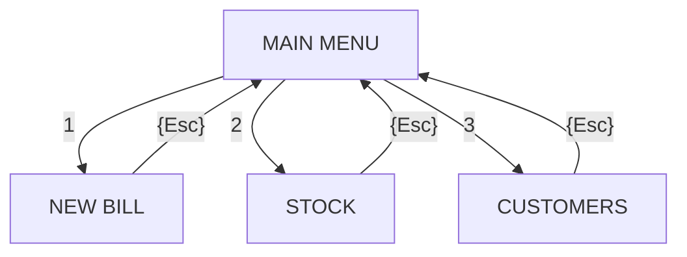

# Design Document: Shifa Medical Store

## Overview

Shifa Medical Store is rebuilt from its Soul (version 1, by reference, from 0 observations). The rules are expressions in the Soul's rule language; they run with decimal arithmetic, never floating point.

## Architecture

The reborn app keeps the old app's shape: the same screens, over one data store for each old DBF file. An action takes a screen's inputs, runs its rules and writes the records it changes. Each rule stays a small expression, so the new code can be tested against it.

How the screens connect, and the keys that move between them:

## Components and Interfaces

### Screens

#### MAIN MENU (`fp_1eb0f03756fc7646`)

- Choice: row 18, column 40, 1 wide
- `1` goes to NEW BILL
- `2` goes to STOCK
- `3` goes to CUSTOMERS

#### NEW BILL (`fp_1ea84e74e2cd7cec`)

- Code: row 21, column 7, 6 wide, bill-item.CODE
- Qty: row 21, column 21, 4 wide, bill-item.QTY
- `{Esc}` goes to MAIN MENU

#### STOCK (`fp_94f36efd8f8e0a33`)

- `{Esc}` goes to MAIN MENU

#### CUSTOMERS (`fp_7ea2aa4052052a22`)

- `{Esc}` goes to MAIN MENU

### Actions

- **Save a bill** (`{Enter}{F2}` on NEW BILL): inserts bill, inserts bill-item, updates medicine

## Data Models

### Medicine (`MEDICINE.DBF`)

| Field | Type | Width | Decimals |
| --- | --- | --- | --- |
| CODE | C | 6 | 0 |
| NAME | C | 20 | 0 |
| BATCH | C | 8 | 0 |
| EXPIRY | D | 8 | 0 |
| PRICE | N | 8 | 2 |
| QTY | N | 5 | 0 |

- Key: CODE

### Customer (`CUSTOMER.DBF`)

| Field | Type | Width | Decimals |
| --- | --- | --- | --- |
| CUST_ID | C | 5 | 0 |
| NAME | C | 25 | 0 |
| PHONE | C | 12 | 0 |

- Key: CUST_ID
- CUST_ID is numbered by the app: `C####`

### Bill (`BILLS.DBF`)

| Field | Type | Width | Decimals |
| --- | --- | --- | --- |
| BILL_NO | C | 9 | 0 |
| BILL_DATE | D | 8 | 0 |
| CUST_ID | C | 5 | 0 |
| SUBTOTAL | N | 11 | 2 |
| DISCOUNT | N | 10 | 2 |
| GST | N | 10 | 2 |
| TOTAL | N | 11 | 2 |

- Key: BILL_NO
- CUST_ID refers to customer (CUST_ID)
- BILL_NO is numbered by the app: `YYMM-####`

### Bill line (`BILLITEM.DBF`)

| Field | Type | Width | Decimals |
| --- | --- | --- | --- |
| BILL_NO | C | 9 | 0 |
| LINE | N | 2 | 0 |
| CODE | C | 6 | 0 |
| QTY | N | 5 | 0 |
| PRICE | N | 8 | 2 |
| AMOUNT | N | 10 | 2 |

- Key: BILL_NO, LINE
- BILL_NO refers to bill (BILL_NO)
- CODE refers to medicine (CODE)

## Rules

| Id | Kind | Target | Expression | Confidence | Evidence |
| --- | --- | --- | --- | --- | --- |
| `discount-over-5000` | compute | bill.discount | `if bill.subtotal > 5000 then trunc(bill.subtotal * 0.10, 2) else 0` | 100% | none yet |
| `gst-17-truncated` | compute | bill.gst | `trunc((bill.subtotal - bill.discount) * 0.17, 2)` | 100% | none yet |
| `bill-total` | compute | bill.total | `bill.subtotal - bill.discount + bill.gst` | 100% | none yet |
| `expired-batch-blocked` | validate |  | `medicine.expiry >= today` | 100% | none yet |
| `qty-over-stock-refused` | validate |  | `item.qty <= medicine.qty` | 100% | none yet |
| `stock-decrement` | effect | medicine.qty | `medicine.qty - item.qty` | 100% | none yet |
| `bill-subtotal` | compute | bill.subtotal | `sum(items, x => x.qty * x.price)` | 100% | none yet |
| `line-price` | compute | bill_item.price | `medicine.price` | 100% | none yet |
| `line-amount` | compute | bill_item.amount | `item.qty * item.price` | 100% | none yet |
| `bill-date` | compute | bill.bill_date | `today` | 100% | none yet |

## Correctness Properties

Each rule is a property of the new code, checked on generated inputs against the rule itself.

### Property 1: `discount-over-5000`

For all inputs, the new code sets the bill discount to the value of `if bill.subtotal > 5000 then trunc(bill.subtotal * 0.10, 2) else 0`.

**Validates: Requirements 1.1, 1.2**

### Property 2: `gst-17-truncated`

For all inputs, the new code sets the bill gst to the value of `trunc((bill.subtotal - bill.discount) * 0.17, 2)`.

**Validates: Requirements 2.1**

### Property 3: `bill-total`

For all inputs, the new code sets the bill total to the value of `bill.subtotal - bill.discount + bill.gst`.

**Validates: Requirements 3.1**

### Property 4: `expired-batch-blocked`

For all entries, the new code accepts an entry exactly when `medicine.expiry >= today` holds, and otherwise refuses it and leaves the data unchanged.

**Validates: Requirements 4.1**

### Property 5: `qty-over-stock-refused`

For all entries, the new code accepts an entry exactly when `item.qty <= medicine.qty` holds, and otherwise refuses it and leaves the data unchanged.

**Validates: Requirements 5.1**

### Property 6: `stock-decrement`

For all saves of "Save a bill", the new code sets the medicine qty to the value of `medicine.qty - item.qty`.

**Validates: Requirements 6.1**

### Property 7: `bill-subtotal`

For all inputs, the new code sets the bill subtotal to the value of `sum(items, x => x.qty * x.price)`.

**Validates: Requirements 7.1**

### Property 8: `line-price`

For all inputs, the new code sets the bill item price to the value of `medicine.price`.

**Validates: Requirements 8.1**

### Property 9: `line-amount`

For all inputs, the new code sets the bill item amount to the value of `item.qty * item.price`.

**Validates: Requirements 9.1**

### Property 10: `bill-date`

For all inputs, the new code sets the bill bill date to the value of `today`.

**Validates: Requirements 10.1**

## Error Handling

The old app refuses an entry that breaks one of these rules, and leaves the data unchanged. The new code must do the same:

- `expired-batch-blocked`: A medicine whose batch has expired cannot be added to a bill. A batch that expires today can.
- `qty-over-stock-refused`: A quantity larger than the stock is refused when the item is added.

## Testing Strategy

- Every rule has a property test (Properties 1 to 10 above): on generated inputs, the new code and the rule's expression must agree. Run each one at least 100 times.
- The old records in the DBF files load into the new data models unchanged.
